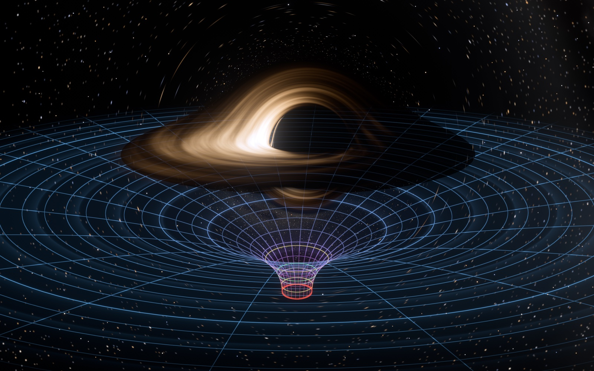
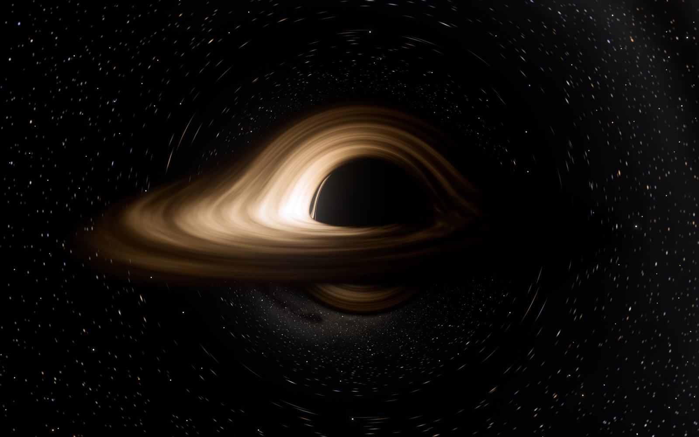
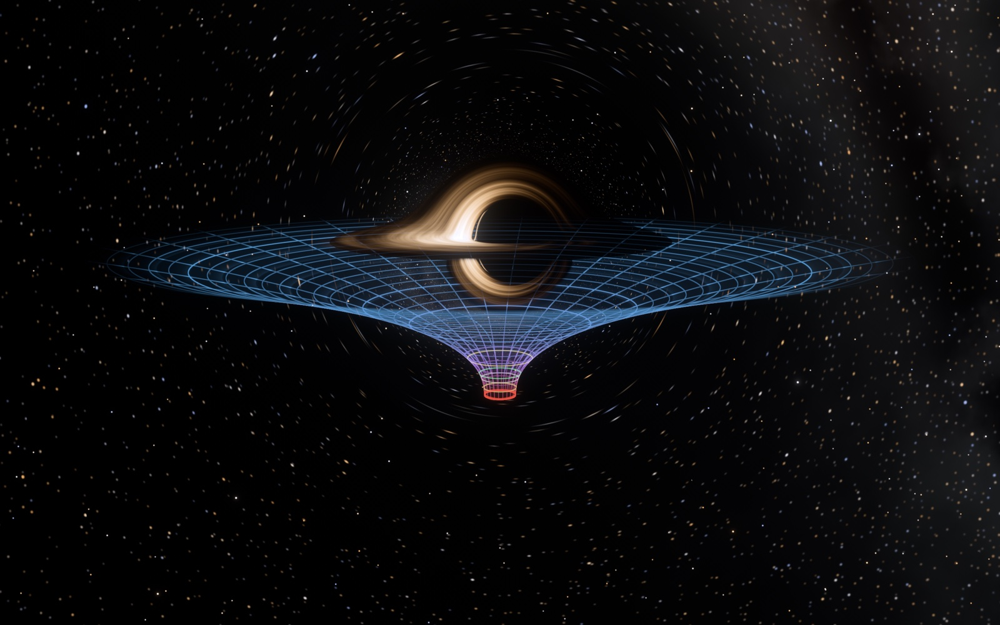
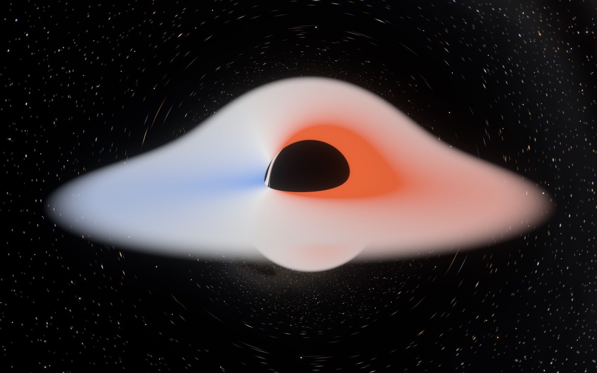
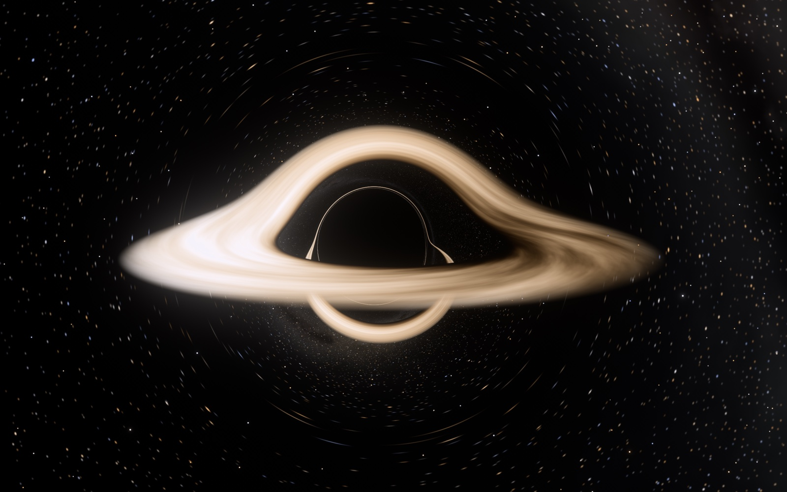

# Kerr black hole — real-time general-relativistic ray tracer

A rotating (Kerr) black hole rendered in real time in C++ / OpenGL. Every pixel
integrates a light ray through the curved spacetime on the GPU, so gravitational
lensing, the black-hole shadow, the photon ring and the warped images of the
accretion disk are computed, not painted.



| | |
|---|---|
|  Kerr hole, a = 0.9, thin disk seen from 78° |  The "trapdoor": embedding diagram of the equatorial plane |
|  Redshift map (key `V`): Doppler + gravitational shift |  Retrograde disk, a = −0.9: photon ring inside the gap |

## Run it

```sh
./run.sh            # configure, build, verify the physics, open the window
```

or by hand:

```sh
cmake -S . -B build -DCMAKE_BUILD_TYPE=Release
cmake --build build
./build/verify      # physics checks, no GPU needed
./build/blackhole   # opens the simulation window
```

Requirements: macOS with a C++17 compiler, CMake ≥ 3.16 and GLFW 3
(`brew install cmake glfw`). It uses OpenGL 4.1 core (which runs on Metal on
Apple silicon); everything else — shaders, sky, tables — is generated by the
program itself, so there are no asset files.

`./build/blackhole --help` lists the command-line options (start view, spin,
window size, `--screenshot file.png --frames N`, `--bench`, …).

## Controls

| Input | Action |
|---|---|
| drag / scroll | orbit the observer / change distance |
| `←` `→` | black-hole spin a/M, from −0.998 (retrograde disk) to +0.998 |
| `↑` `↓` | disk temperature |
| `[` `]` | exposure |
| `,` `.` | speed of time |
| `-` `=` / `9` `0` | disk outer radius / field of view |
| `G` | spacetime funnel (embedding diagram) on/off |
| `K` | funnel grid: polar with rings at equal proper distance / draped Cartesian |
| `L` | coordinate grid on the equatorial plane, seen through the lens |
| `D` `T` `N` | disk on/off, turbulence on/off, limb darkening on/off |
| `B` | Doppler boosting + gravitational redshift on/off (off is unphysical — for comparison) |
| `V` | redshift map instead of physical colours |
| `X` | sky on/off |
| `1`–`7` | views: overview · near-extremal edge-on · Schwarzschild (Luminet 1979) · face-on · trapdoor · close approach · lensed grid |
| `Space` | pause. While paused the image refines: full resolution, half the integration step, 96× supersampling |
| `O` `S` `F` `H` `Esc` | auto-orbit · screenshot (PNG) · fullscreen · hide text · quit |

Hold `Shift` for fine adjustment.

## What is computed

Units are G = c = M = 1; lengths are in gravitational radii GM/c².

### Light: null geodesics of the Kerr metric

* **Coordinates.** Cartesian Kerr–Schild, g = η + f l⊗l with
  f = 2r³/(r⁴ + a²z²). They have no coordinate singularity at the horizon or on
  the spin axis, so nothing special happens at the poles and captured rays cross
  r₊ cleanly.
* **Equations.** Hamilton's equations for H = ½ g^{μν} p_μ p_ν with analytic
  gradients (six first-order ODEs plus the coordinate time), integrated with
  classical RK4. The step is a fixed fraction of r — constant angular resolution
  around the hole — tightened inside 6 M and relaxed in the weak field.
* **Backward tracing without the horizon pile-up.** A pixel needs the photon
  that *arrived* at the camera. Kerr is invariant under (t, a) → (−t, −a), so
  that photon traced backwards through a hole of spin a is a photon traced
  forwards through a hole of spin −a, with all matter velocities reversed. In
  that picture rays that hit the hole simply fall through the horizon.
* **Far field.** Once a ray is outgoing beyond 60 M the remaining bending is
  added analytically, to first order in M in the same radial gauge,
  δψ = (M/b)(1 − c)²(2 + c). The neglected part is O(M²/r²) ≲ 3×10⁻⁴ rad.
* **Observer.** A static observer with an orthonormal tetrad built by
  Gram–Schmidt in the actual metric (double precision, on the CPU). Pixel
  directions are local directions in that frame, so the view stays correct close
  to the hole. Starlight is blueshifted by the observer's gravitational
  potential (intensity × g⁴).

### Accretion disk

* **Model.** Novikov–Thorne: geometrically thin, optically thick, gas on
  circular geodesics, inner edge at the ISCO with zero torque. The flux profile
  F(r) is the Page & Thorne (1974) integral evaluated by quadrature for the
  current spin, and T(r) ∝ F^{1/4}.
* **Redshift.** g = E_obs/E_emit is computed for every hit from the photon's
  momentum and the gas four-velocity, normalised with the Kerr–Schild metric
  itself. It contains Doppler shift, gravitational redshift and frame dragging
  with no approximation.
* **Colour and brightness.** I_ν/ν³ is Lorentz invariant, so a blackbody at T
  seen with redshift g is exactly a blackbody at gT. Colours come from Planck's
  law integrated against the CIE 1931 colour-matching functions → linear sRGB.
  Nothing is tinted by hand: the approaching side is hotter-looking and far
  brighter, the receding side redder and dim.
* **Limb darkening** of an electron-scattering atmosphere, I(μ) ∝ 1 + 2μ, with
  μ evaluated in the gas rest frame.
* **Halos.** The disk is opaque, the region inside the ISCO is empty. Rays that
  pass through that gap and loop around the hole produce the secondary image
  under the shadow and the thin photon ring; they are not added separately.
* **Turbulence** (optional, `T`) is a procedural emissivity pattern carried at
  exactly the local Keplerian angular velocity and evaluated at the *emission*
  time, so differential rotation and light-travel-time delays are real. The
  pattern itself is illustrative.

### Stars

Bright stars are point sources: lensing changes their *flux* by the
magnification μ = (solid angle of a pixel)/(solid angle of sky it sees), taken
from the Jacobian of the lens map. They brighten into arcs near the Einstein
ring. Faint stars and the galactic band are a procedural cube map.

### The spacetime grid

The funnel is not a cartoon potential well. It is the equatorial plane
(Boyer–Lindquist t = const) embedded isometrically in flat 3-space — Flamm's
paraboloid, z = √(8M(r − 2M)), for a = 0 and its Kerr generalisation
(dz/dr)² = r²/Δ − (dR/dr)², R² = r² + a² + 2Ma²/r. Distances measured along the
surface are the true proper distances.

* Rings are 2 M of ruler distance apart, so their crowding in the picture *is*
  the stretching of space.
* Colour is the clock rate relative to infinity (blue → red as time slows).
* Pulses travel inwards at the speed of observers falling from rest at infinity
  (the "river" picture), reaching the horizon — the red rim, where the surface
  becomes vertical and the diagram ends.
* Marked rings: horizon (red), ergosphere (white), photon orbits (yellow),
  ISCO (green).

The funnel is a diagram of the geometry drawn in the same view, hidden where
the hole or the opaque disk is in front of it. It hangs below the equatorial
plane only because the embedding needs a direction that does not exist in real
space. `L` shows the complementary, fully physical picture: a coordinate grid
painted on the equatorial plane and seen along the curved light paths.

## Verification

`./build/verify` compiles **the same file the GPU runs**
(`shaders/kerr_geodesic.glsl` is written in the common subset of GLSL and C++)
and checks it against closed-form general relativity, once in float64 and once
with every operation forced to float32 like the GPU. Current results at the
real-time step size (85 checks, all passing):

| Check | Reference | Error (float32) |
|---|---|---|
| Schwarzschild capture radius | b = 3√3 M | 2×10⁻⁵ |
| Kerr photon orbits, a = 0.5, 0.9, 0.998, both senses | b = ±3√r_ph − a | ≤ 3×10⁻⁵ |
| Light deflection, b = 5.5 … 400 M | exact elliptic integral | ≤ 5×10⁻⁴ rad (≤ 4×10⁻⁵ for b ≥ 12 M) |
| Shadow rim, three spin/inclination pairs | Bardeen's critical curve η(ξ) | ≤ 1×10⁻³ |
| Disk redshift, a = −0.5 … 0.998, all image orders | 1/[u^t(E − ΩL_z)] | ≤ 9×10⁻⁶ |
| Face-on Schwarzschild disk | g = √(1 − 3M/r) | 8×10⁻⁶ |
| Conserved H, L_z, Carter Q along escaping rays | 0 drift | ≤ 2.5×10⁻⁴ |
| Travel time of radial photons | Shapiro delay, closed form | ≤ 9×10⁻⁴ |
| Novikov–Thorne flux (quadrature) | Page & Thorne closed form, 5 spins | ≤ 3×10⁻⁵ |
| Embedding, a = 0 | Flamm's paraboloid | 6×10⁻¹⁴ |
| Blackbody chromaticity at 2856, 6500, 10000 K | Planckian locus | ≤ 0.002 in xy |

For scale, one pixel is about 4×10⁻⁴ rad at 2880×1800. Pausing halves the step,
which cuts these integration errors by a factor of 10–20 (`./build/verify 0.1`).

## Performance

About 6 ms of GPU time per frame at 2880×1800 on an Apple M4 Max in the default
view. Resolution scales automatically to hold 60 fps on slower GPUs
(`--fps N` changes the target, `--scale S` fixes the scale).

## Limits of the model

* The disk has zero thickness and no emission inside the ISCO; no returning
  radiation, no spectral hardening, no polarisation.
* The default peak temperature (5000 K) is chosen so the colour gradient falls
  in the visible band. Real disks are hotter — T_max scales as (Ṁ/M²)^{1/4} and
  is ~10⁵ K for a luminous quasar — and would look blue-white; use `↑`.
  The temperature *profile* is the physical one.
* The sky is procedural scenery, and its brightness relative to the disk is a
  free choice (a real disk would outshine the stars).
* Glare (bloom) and the tone curve model a camera, not the hole.
* The observer is static; there is no aberration from observer motion, and the
  observer cannot go inside the ergosphere.
* Rays extremely close to the critical curve run out of integration steps and
  are drawn black: within ~10⁻³ (relative impact parameter) on the prograde
  side at a = 0.9, ~10⁻¹² for a = 0. Only a sliver of the highest-order
  photon-ring images is lost.

## Layout

```
shaders/kerr_geodesic.glsl   Kerr-Schild geodesic integrator (GPU + CPU tests)
shaders/raytrace.frag        camera rays, disk emission, point-source stars
shaders/stars.glsl           procedural star catalogue
shaders/sky_gen.frag         bakes the sky cube map at start-up
shaders/grid.vert|frag       embedding-diagram funnel
shaders/bloom_*, composite   glare, exposure, tone curve, sRGB
src/physics.hpp              Kerr radii, circular orbits, disk flux, tetrad, embedding
src/blackbody.hpp            Planck × CIE 1931 → linear sRGB table
src/main.cpp                 window, input, frame pipeline, dynamic resolution
src/hud_text.cpp             on-screen read-out (CoreText)
tests/verify.cpp             physics verification
```

## References

* J. M. Bardeen, W. H. Press, S. A. Teukolsky, *ApJ* 178, 347 (1972) — Kerr orbits, ISCO
* J. M. Bardeen, in *Black Holes* (Les Houches 1972) — shadow of a Kerr hole
* I. D. Novikov, K. S. Thorne (1973); D. N. Page, K. S. Thorne, *ApJ* 191, 499 (1974) — thin-disk flux
* C. T. Cunningham, *ApJ* 202, 788 (1975) — redshift and transfer of disk emission
* J.-P. Luminet, *A&A* 75, 228 (1979) — first image of a disk around a black hole
* O. James, E. von Tunzelmann, P. Franklin, K. S. Thorne, *CQG* 32, 065001 (2015) — lensing of point-like stars
* C. Wyman, P.-P. Sloan, P. Shirley, *JCGT* 2(2), 2013 — analytic CIE colour-matching fits
