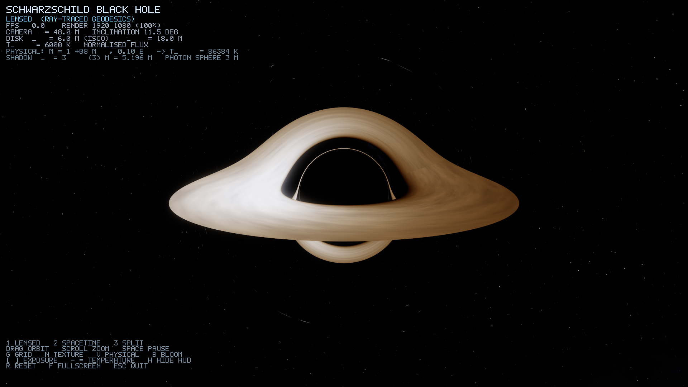
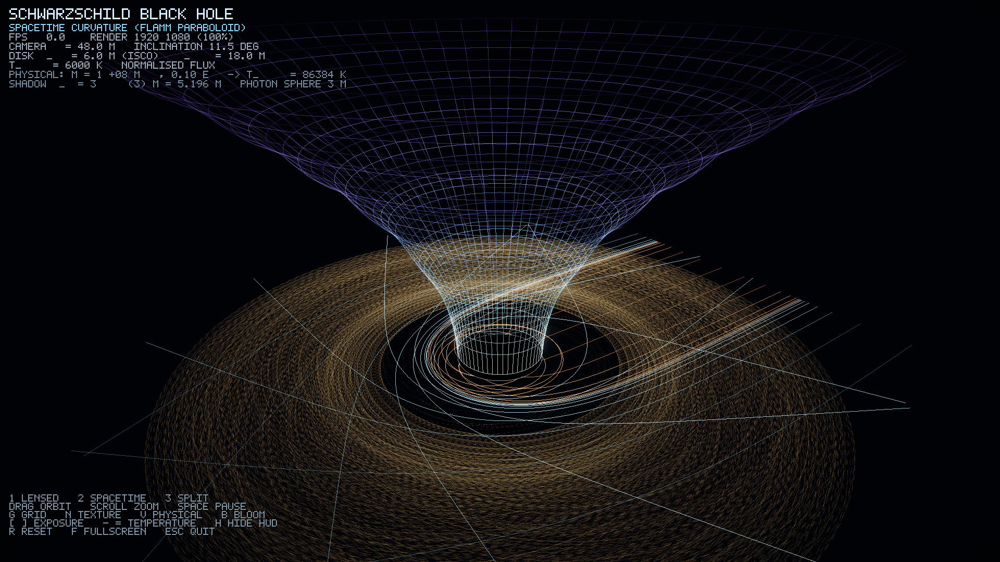

# Schwarzschild Black Hole — Real-Time Ray-Traced Relativistic Renderer

A physically grounded, real-time 3D black hole simulation in C++17 / OpenGL 4.1.
Every pixel is produced by integrating null geodesics of the Schwarzschild metric
backwards from the camera, so gravitational lensing, the photon ring, the black-hole
shadow and the Doppler/gravitational shifts of the accretion disk all emerge from the
geometry rather than being faked with sprites or screen-space distortion.



## Build & run

```bash
./build.sh          # configure + compile (CMake, needs GLFW + GLEW)
./run.sh            # launch the interactive window
```

Or manually:

```bash
cmake -S . -B build -DCMAKE_BUILD_TYPE=Release
cmake --build build -j
./build/bin/blackhole
```

Requirements: macOS or Linux, a GPU with OpenGL 4.1 core, GLFW 3.3+, GLEW.
No other dependencies — the vector math, PNG writer and bitmap font are all in-tree.

## The three views

Press `1`, `2`, `3`.

| Key | View | What it shows |
|-----|------|---------------|
| `1` | **Lensed** | Ray-traced geodesics: shadow, photon ring, Einstein ring, disk lensed over and under the hole |
| `2` | **Spacetime** | Flamm paraboloid embedding diagram — the "trapdoor" funnel, with geodesics and plunging particles |
| `3` | **Split** | Both, side by side |



## Physics

Geometric units, `G = c = M = 1`. Then `r_s = 2`, photon sphere `r = 3`,
ISCO `r = 6`, critical impact parameter `b_c = 3√3 ≈ 5.19615`.

**Null geodesics.** Photons in Schwarzschild obey, in Cartesian form,

```
d²x/dλ² = -(3/2) r_s h² x / r⁵ ,   h = |x × v| = const
```

which is the exact Schwarzschild null orbit equation (not a weak-field
approximation). Integrated with classical RK4 and an adaptive step
`dλ = clamp(0.05 r²/(h+1), 0.002, 0.15 r)`. Rays terminate on the horizon
(`r < r_s`), at the disk, or at the celestial sphere.

**Massive particles** (the plunging matter in the spacetime view) use

```
d²x/dλ² = -x/r³ - 3h²x/r⁵
```

**Accretion disk.** Geometrically thin, optically thick, in the equatorial plane
between the ISCO and an outer radius. Surface temperature follows the
Novikov–Thorne / Shakura–Sunyaev profile

```
Θ(x) = x^(-3/4) (1 - x^(-1/2))^(1/4) / 0.487871 ,   x = r/r_in
```

normalised so the peak is unity; the peak sits at `x = 49/36`, as it should.
Turbulent texture is advected with the Keplerian shear `Ω = √(M/r³)`, so the
inner disk visibly laps the outer disk.

**Redshift.** Each disk hit is shifted by the full relativistic factor

```
g = 1 / (u^t (1 - Ω b_z)) ,   u^t = 1/√(1 - 3M/r)
```

which combines gravitational redshift, transverse Doppler and the longitudinal
Doppler of the orbital motion. The observed spectrum is exactly a blackbody at
`T_obs = g·T_emit`, so the colour is computed by evaluating a Planck spectrum at
`T_obs` — no ad-hoc tinting. That single factor produces the characteristic
asymmetry: the approaching side is boosted and blue, the receding side dimmed
and red.

**Colour.** Planck spectrum × analytic CIE 1931 colour-matching fit
(Wyman et al. 2013) → linear sRGB, with an absolute visible-band radiance LUT
(1024 entries, 700–250000 K). Physical mode (`V`) uses real radiance; the
default display mode normalises for a pleasing image.

**Physical scale.** `M = 10⁸ M☉` at `0.1` Eddington gives `T_peak ≈ 86 400 K` —
a UV-dominated quasar "big blue bump", which is what the physics actually
predicts for a supermassive black hole of that mass.

## Validation

`./build/bin/physics_tests` runs **36 checks, 0 failures**:

- Light deflection vs. the 3-term post-Newtonian series (agreement to 1e-4 relative)
- Critical impact parameter `b_c = 3√3` (1.1e-6 relative)
- Photon-sphere turning points and unstable-orbit behaviour
- Conservation of `E` and `h` along integrated rays (1e-6)
- ISCO orbital velocity `β = 0.5`
- Redshift factors against closed-form values, including the sign convention
- Novikov–Thorne profile shape and peak location
- `T_peak` scaling with mass and accretion rate
- Wien peak at 501.5 nm for a 5778 K blackbody
- Blackbody hue ordering (cool → red, hot → blue-white)

## Controls

| Input | Action |
|-------|--------|
| Drag / scroll | Orbit / zoom |
| `1` `2` `3` | Lensed / Spacetime / Split |
| `G` | Toggle spacetime grid |
| `N` | Toggle disk texture |
| `V` | Physical vs. display radiance |
| `B` | Toggle bloom |
| `[` `]` | Exposure down / up |
| `-` `=` | Disk temperature |
| `,` `.` | Disk inner/outer radius |
| `T` | Gamma |
| `O` | Auto-orbit |
| `R` | Reset view |
| `F` | Fullscreen |
| `H` | HUD |
| `Esc` | Quit |

## CLI

```
--still out.png     render one high-quality frame and exit
--bench N           render N frames, report fps, exit
--width N --height N
--mode 0|1|2
--samples N         temporal samples for --still (anti-aliasing)
--scale F           internal render scale
--yaw --pitch --dist --fov
--temp --exposure
--physical --nostars --nobloom --notex --nohud
```

## Performance

Measured on an Apple M4 Max, internal resolution after 2× Retina scaling:

| Mode | Internal res | FPS |
|------|--------------|-----|
| Lensed | 3200×1800 | 102 |
| Spacetime | 3200×1800 | 837 |
| Split | 3200×1800 | 175 |
| Lensed | 2560×1440 | 158 |

Comfortably realtime. Temporal accumulation with jittered sampling converges the
image while the camera is still and resets on movement, so the view stays sharp
while you drag and cleans up when you stop.

## Honest notes

Two knobs are deliberately *not* physically literal, and are labelled as such:

- **`diskCompress`** (default 0.45) compresses the >100:1 dynamic range of the
  visible-band disk emission for display. The underlying radiance is physical;
  the tone mapping is not. Physical mode (`V`) bypasses this.
- **`gridZScale`** (default 1.5) vertically exaggerates the Flamm paraboloid so
  the funnel throat is visible at a comfortable camera distance. The embedding
  geometry itself is exact.

The disk is a thin-disk model: it has no vertical structure, no self-illumination
by returning radiation, and no magnetohydrodynamic turbulence — the texture is a
procedural stand-in for the shear pattern, not a simulation of it. Frame dragging
is absent because the metric is Schwarzschild, not Kerr; a real rapidly spinning
black hole would have an asymmetric shadow and a disk reaching closer in.

## Layout

```
src/math3d.h        Vec3 / Mat4, perspective, lookAt
src/physics.h       constants, Novikov-Thorne, redshift, ISCO
src/blackbody.*     Planck, CIE fit, radiance LUT
src/geodesic.*      null + massive geodesic integrators
src/gridscene.*     Flamm paraboloid, horizon, geodesics, particles
src/renderer.*      ray-trace pass, accumulation, bloom, composite, HUD
src/shaders/        GLSL for every pass
tests/physics_tests.cpp
```
