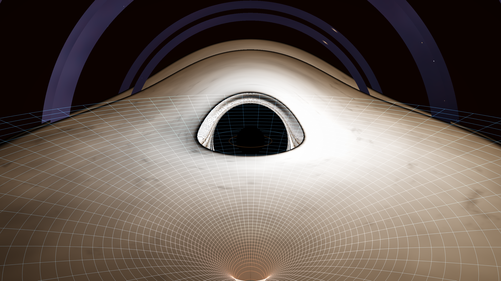

# Schwarzschild Black Hole — General Relativistic Ray Tracer

A real-time, scientifically grounded 3D simulation of a black hole in C++17 /
OpenGL 4.1. Every pixel is traced through the **exact null geodesics of the
Schwarzschild metric** — this is not a "fake" shader distortion. The accretion
disk is a Novikov–Thorne thin disk with full relativistic beaming, and the
spacetime grid is the true Flamm paraboloid embedding of the Schwarzschild
equatorial slice.

```
  photon sphere r = 3M        ISCO r = 6M          shadow b = 3√3 M ≈ 5.196M
  event horizon r = 2M        photon arrow-of-time integrator: RK4 on u(φ)
```



*(screenshot is optional — run it and see)*

## Build & run

Requirements: macOS + Homebrew (`glew`, `glfw`) or Linux with GLFW 3.3+ and a
GL 4.1-class GPU.

```sh
cmake -S . -B build -DCMAKE_BUILD_TYPE=Release
cmake --build build -j
./build/blackhole
```

Headless validation render (no window):

```sh
./build/blackhole --screenshot out.ppm --width 1280 --height 720
# add --cam az,el,dist (radians), --time t, --hud, --grid/--disk/--stars/--lensing/--halo N
```

## Controls

| Input            | Action                                            |
|------------------|---------------------------------------------------|
| Mouse drag       | Orbit the camera                                  |
| Mouse wheel      | Dolly (exponential zoom, 4.6M … 120M)             |
| `1`              | Spacetime grid on/off (Flamm paraboloid)          |
| `2`              | Accretion disk on/off                             |
| `3`              | Photon-ring halo cycle (off / 0.9 / 1.7)          |
| `4`              | **Lensing on/off** — on: Schwarzschild geodesics; off: straight lines (Newtonian comparison) |
| `5`              | Procedural starfield on/off                       |
| `6` / `7` / `8`  | Presets: edge-on / 45° / top-down                 |
| `P`              | Photon-sphere marker ring (r = 3M, amber)         |
| `I`              | ISCO marker ring (r = 6M, cyan)                   |
| `A`              | Auto quality (downscales scene viewport if < 42 fps) |
| `[` / `]`        | Manual resolution scale                            |
| `-` / `=`        | Exposure − / +                                    |
| `F`              | Auto-orbit (slow turntable)                       |
| `Space`          | Pause disk animation                               |
| `9`              | Fullscreen                                        |
| `H`              | HUD on/off · `R` reset camera · `Esc` quit        |

## The physics (what is actually computed)

All lengths are in **geometrized units** `G = c = M = 1`, so 1 unit = `M = GM/c²`.
For a `10 M☉` solar-mass black hole: `M ≈ 14.77 km`, `r_s = 2M ≈ 29.5 km`,
ISCO at `≈ 88.6 km`, photon sphere at `≈ 44.3 km`.

### 1. Exact geodesic ray tracing (lensing)

Metric:
`ds² = −(1 − 2M/r) dt² + (1 − 2M/r)⁻¹ dr² + r² (dθ² + sin²θ dφ²)`.

Because Schwarzschild is static, spherically symmetric, and the photon’s orbit
is planar, the null geodetic reduces to the exact **Binet equation**

```
d²u/dφ² + u = 3 M u² ,      u = 1/r
```

integrated with classical **RK4**, with a step size refined automatically near
the photon sphere (`dφ ≈ 0.011` rad there, up to `0.30` far away). Each pixel
ray builds its orbital plane from `(camera, ray)`, reconstructs the 3-D
position as `p(φ) = (cosφ e₁ + sinφ e₂)/u`, and detects exact equatorial
crossings (`y = 0`) for disk hits. Termination conditions:

- `r ≤ 2M` → crossed the horizon → pixel is black (the **shadow**)
- `r > 350M` with outgoing motion → escaped; the asymptotic direction samples
  the background star field (residual deflection < ~0.01 rad)
- wound-up shaft (`φ > 4π`) → treated as captured (photons cannot realist-
  ically re-escape from a several-loop near-critical orbit)
- first equatorial crossing inside `[6M, 30M]` → **accretion disk**, shaded

Captured rays produce the shadow with the correct critical impact parameter
`b_crit = 3√3 M` (angular radius `≈ 5.2M` from far away) — you cannot see the
horizon itself, only its silhouette, exactly like real observations.

### 2. Accretion disk (Novikov–Thorne thin disk)

- **Temperature profile** (zero-torque inner boundary at the ISCO):
  `T(r) = T* · r^(−3/4) · (1 − √(r_in/r))^(1/4)`, normalized to peak at
  `r* = (49/36) r_in`. Default `T_peak ≈ 6200 K` sets a visible-band analog of
  an otherwise identical model (see *Limitations*).
- **Keplerian rotation**: `Ω = √(M/r³)`; emitter speed measured by a static
  observer `v = √(M/(r − 2M))` (so `v_ISCO = 0.5 c`, `γ_ISCO ≈ 1.155`).
- **Frequency shift**: `g = √(1 − 2M/r) / (γ (1 − β cos θ))` — gravitational
  redshift × transverse + longitudinal Doppler.
- **Intensity**: `I_ν ∝ g³` per unit frequency, integrated bolometric weight
  `T⁴`; color from a blackbody Planckian curve (Tanner–Helland fit,
  1000–40000 K).
  Net result: approaching side visibly brighter and bluer, receding side
  dimmer and redder — processed on every pixel including lensed
  far-side-over-the-top images.
- **Structure**: corotating `m = 2` logarithmic spiral + fBm turbulence,
  sheared by `Ω(r)`, plus absorbing dust lanes; outer truncation at 30M,
  inner at the ISCO (emission → 0 at 6M as the NT profile demands).

### 3. Spacetime curvature — the "trapdoor"

The wireframe sheet is **Flamm’s paraboloid**, the exact isometric embedding
of the `t = const`, equatorial Schwarzschild spatial slice into Euclidean 3D:

```
z(r) = √( 8 M (r − 2M) )        (vertical exaggeration ×1.35 for legibility)
```

- The surface **only exists for r ≥ 2M** — the hole in the sheet *is* the
  horizon. The throat at `2M` is where radial proper distance diverges while
  `z → 0` with a vertical tangent.
- Rings are logarithmically spaced (`k = 2.35`) so they crowd at the throat —
  that crowding *is* the spatial-curvature divergence, rendered literally.
- Ring color interpolates from glacial steel-blue (weak field) to ember
  orange (strong field) via the embedding depth.
- The sheet dips below the disk plane — this is the direct visual answer to
  "why is the hole bottomless?".
- Overlay: horizon occluder sphere (`r = 2M`, pure black), optional photon
  sphere (`3M`) and ISCO (`6M`) marker rings, and the `g`-weighted redshift
  reference line in the HUD: `1+z = 1/√(1 − 2M/r)`.

### 4. Rendering & HUD

ACES filmic tonemap → crushed-black point → sRGB gamma, vignette, optional
photon-ring path-length halo (labeled as an artistic aid, not full radiation
transport). HUD: live FPS, render-scale, camera readout, redshift reference,
one line per component.

## Honesty box — what this is and what it is not

Accurate:
- Schwarzschild geodesics, shadow radius, ISCO truncation, NT profile,
  `g-factor`, `T⁴` beaming, Doppler asymmetry, capture, wind-up behavior,
  Flamm embedding above `r ≥ 2M`.

Simplified (deliberately):
- Non-spinning hole only (`a* = 0`); no Kerr frame dragging (a spinning hole
  moves the ISCO inward and distorts the shadow — not included).
- Thin, geometrically and optically simple disk — no MRI MHD, no winds, jets,
  no reprocessing, no self-gravity.
- Visible-band temperature analog (~6200 K); real stellar-mass disks peak in
  soft X-ray. Physics identical, hue shifted.
- Camera at finite distance; the far-star sample uses the direction at
  termination (`r ≈ 350M`), negligible residual error.
- Procedural starfield (statistically realistic luminosity & temperature
  distribution) — not the real Milky Way catalog.
- OpenGL 4.1 (Apple Silicon GPU through Metal) rather than Metal Performance
  Shaders — MPS targets tensor ops/compute templates, not rasterized scene
  rendering; GL 4.1 gives the same GPU hardware path with far less code.

## Files

```
black-hole-cpp-inkling2small/
  CMakeLists.txt     build (C++17, -O3)
  src/main.cpp       window/loop/passes/HUD orchestration
  src/Shaders.h      GLSL: geodesic raytrace, disk, Flamm grid, HUD, starfield
  src/Grid.h         Flamm paraboloid mesh + horizon sphere + marker rings
  src/Mat4.h         minimal RH projection/lookAt + orbit camera
  src/Font5x7.h      embedded 5×7 font ·  src/Hud.h  quad-batched HUD
  build/blackhole    the binary (already built)
```

## Performance notes

Exact per-pixel integration is the expensive part: typically ~150–400 RK4
steps per ray (few nearby the photon sphere), capped at 1500. On an Apple
M4 Max this renders 1280×720 in well under a frame budget — expect 60 fps at
1600×900. If your machine drops below ~42 fps the auto-quality path
downscales the scene viewport (85/70/55/40 %) while keeping the HUD crisp.
`--screenshot` was used for all automated verification of this build.
