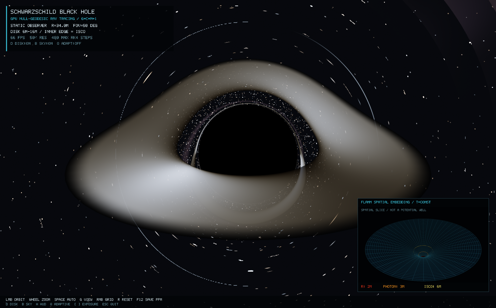

# Schwarzschild — C++/OpenGL relativistic black-hole renderer

A native, realtime 3D visualization of a non-spinning black hole. Every camera ray is integrated through the exterior Schwarzschild geometry on the GPU; gravitational lensing is **not** a screen-space distortion.



## Run

Requirements: macOS, a C++17 compiler, CMake, GLFW 3, and OpenGL 3.3 or newer. On this machine all dependencies are already installed.

```bash
cd black-hole-cpp-kimi-k3-1
./run.sh
```

The script builds in Release mode and opens a new realtime window. To build manually:

```bash
cmake -S . -B build -DCMAKE_BUILD_TYPE=Release
cmake --build build -j 8
./build/black-hole
```

Run the numerical checks with:

```bash
ctest --test-dir build --output-on-failure
```

## Controls

| Input | Action |
|---|---|
| Left drag | Orbit the static observer around the black hole |
| Mouse wheel / `W` `S` | Decrease / increase observer radius |
| Up / down arrows | Decrease / increase vertical field of view |
| Right drag | Orbit the embedding diagram |
| Shift + wheel | Zoom the embedding diagram |
| `G` | Cycle lensing + inset → lensing only → embedding only |
| `Space` | Toggle automatic observer orbit |
| `D` | Toggle the accretion disk |
| `B` | Toggle background stars |
| `Q` | Toggle adaptive internal resolution |
| `[` / `]` | Decrease / increase display exposure |
| `H` | Toggle HUD |
| `R` | Reset the simulation |
| `F12` | Save `black-hole-screenshot.ppm` in the working directory |
| `Esc` | Quit |

## What is simulated

- **Schwarzschild spacetime**, in geometrized units `G = c = M = 1`.
- **Null-geodesic ray tracing** in each ray's conserved orbital plane using RK4 integration of `u'' + u = 3u^2`, where `u = 1/r`.
- **Capture and escape**, including the horizon at `2M`, photon sphere at `3M`, and critical impact parameter `3 sqrt(3) M`.
- **Accretion-disk higher-order images**: disk-plane intersections are found along each curved ray, producing direct, far-side, and halo images from the same geometry.
- **Relativistic disk shading**: circular geodesic motion, gravitational redshift, special-relativistic Doppler shift, and `g^4` bolometric beaming.
- **Thin-disk radial emission**: a zero-torque radial flux profile beginning at the `6M` ISCO and ending at a display-selected `16M` outer boundary.
- **Procedural celestial sphere at infinity**, sampled using the escaped ray direction so all apparent distortion is caused by the geodesic.
- **Flamm embedding diagram** with a 3D radial/azimuthal grid and labeled horizon, photon-sphere, and ISCO rings.

See [PHYSICS.md](PHYSICS.md) for equations, initial conditions, redshift conventions, validation, and limitations.

## Realtime rendering

The fragment shader renders into an HDR framebuffer, followed by ACES tone mapping. Adaptive quality changes only internal resolution (35–100%); it does not change the geodesic equation, disk physics, or maximum integration angle. The HUD reports measured FPS and current resolution.

Command-line options:

```text
--view N           0=lensing+grid, 1=lensing only, 2=grid only
--scale X          Initial resolution scale, 0.35 to 1.0
--no-adapt         Disable adaptive resolution
--screenshot PATH  Save a PPM after a fixed number of frames and exit
--frames N         Frame count for --screenshot (default 45)
--help             Print all options
```

For example:

```bash
./build/black-hole --view 0 --scale 0.65
./build/black-hole --view 2
./build/black-hole --screenshot frame.ppm --frames 60 --no-adapt
```

## Scope and honest approximations

This is a Schwarzschild visualization, not a Kerr or GRMHD solver. The disk is a stationary, axisymmetric, geometrically thin emitting sheet with fixed display opacity; it does not simulate fluid turbulence, magnetic fields, disk thickness, or retarded-time dynamics. `T_max = 7000 K` is an illustrative display normalization, not a claim about a particular astrophysical black hole. Three-primary Planck colors and tone mapping are visualization choices.

The Flamm diagram is an embedding of the **constant-time, equatorial spatial metric**, not four-dimensional spacetime and not a Newtonian gravitational potential. The UI labels this distinction in the grid-only view.

## Source layout

```text
src/main.cpp          Window, input, HDR pipeline, camera, adaptive quality
src/physics.hpp       CPU Schwarzschild reference used by tests
src/embedding.cpp     Flamm mesh and 3D grid
src/overlay.cpp       Dependency-free HUD
shaders/blackhole.frag GPU null geodesics, disk crossings, redshift, sky
shaders/              Presentation, embedding, and overlay shaders
tests/                Numerical Schwarzschild validation
```
