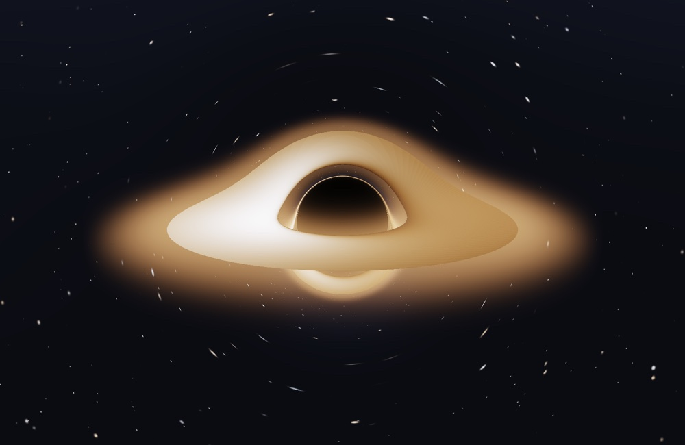
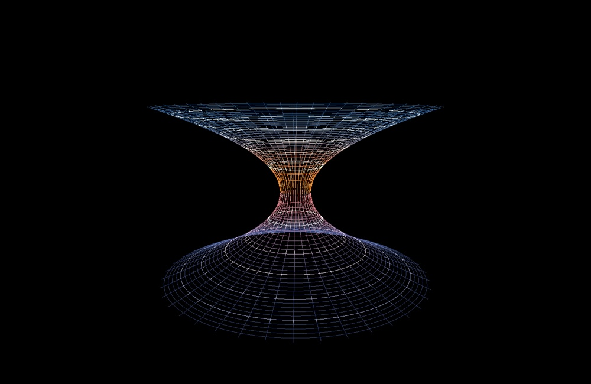
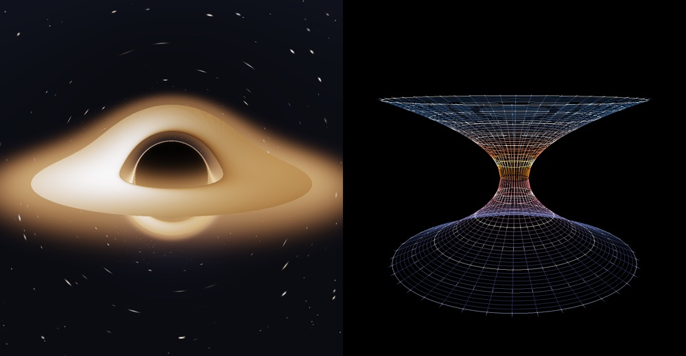

# Schwarzschild Black Hole — real-time general-relativistic ray tracer

A from-scratch, GPU-accelerated simulation of a non-rotating (Schwarzschild)
black hole, written in C++17 with OpenGL/GLSL. It opens a window and runs in
real time on the GPU. Everything physical is derived from the Einstein field
equations — no other black-hole rendering code was consulted.

**Rendered by this program (not stock images):**

| Ray-traced black hole (gravitational lensing + accretion disk) | Spacetime-curvature grid ("trapdoor", Flamm paraboloid) |
|---|---|
|  |  |



*Left / above:* exact null-geodesic ray marching, relativistic beaming, photon
ring, lensed disk halos, Einstein-ring starfield. *Right:* embedded equatorial
spatial slice (Einstein–Rosen bridge). *Split:* both, one orbitable camera.
The flat-spacetime comparison (`--flat`, lensing off) is at
`docs/preview_flat.jpg` — note the un-warped disk, small Newtonian shadow and
round, un-lensed stars.

---

## 1. Quick start (macOS, Apple Silicon / Intel)

```bash
brew install glfw glm          # dependencies (pkg-config finds glfw3)
./build.sh                     # configures with CMake and builds ./build/blackhole
./build/blackhole              # opens the real-time window
```

Other things you can run:

```bash
./build/blackhole --selftest                 # numerical GR checks, NO window needed
./build/blackhole --headless frame.png      # render one frame to a PNG, no window
./build/blackhole --headless f.png --mode grid
./build/blackhole --headless f.png --mode split --w 1600 --h 900
./build/blackhole --headless f.png --bench 60   # measure real-time FPS
./build/blackhole --help
```

`--selftest` and `--headless` are also a convenient way to verify the build on a
machine without wanting an interactive window. `--selftest` needs **no** OpenGL
context at all.

### Requirements
- macOS with the (deprecated but present) `OpenGL.framework`; a **3.3 core-profile**
  context is requested. Runs on Apple GPUs via the Metal-backed OpenGL driver.
- GLFW 3 (`brew install glfw`, found through `pkg-config`), GLM (header-only),
  CMake, a C++17 compiler (Apple Clang).
- Linux: the code links `OpenGL::GL`, but a GL function loader (glad/glew) is
  still required there since non-Apple platforms don't export `gl*` symbols
  directly. See the note in `src/main.cpp`. The primary, tested target is macOS.

---

## 2. Controls (interactive window)

| Input | Action |
|---|---|
| Mouse drag | orbit camera (azimuth / inclination) |
| Scroll | zoom (camera distance) |
| `1` / `2` / `3` | **Lensing view** / **Spacetime grid** / **Split screen** |
| `D` | toggle accretion disk |
| `L` | toggle **gravitational lensing** (curvature on/off — a Newtonian comparison) |
| `R` | toggle **relativistic** gravitational redshift + Doppler beaming |
| `S` | toggle background starfield |
| `H` | toggle coronal halo / infall animation |
| `P` | save a PNG screenshot of the current frame |
| `[` / `]` | fewer / more geodesic integration steps (quality vs. speed) |
| `-` / `=` | lower / higher internal render resolution |
| `Space` | pause / resume the disk animation |
| `Q` / `Esc` | quit |

The window title shows the live FPS, mode, quality, and toggle states.

### Command-line / headless options
`--w N --h N` window/frame size, `--mode bh|grid|split`, `--time T` animation
time, `--bench N` benchmark N frames (headless), `--frames N` auto-quit after N
rendered frames (interactive), `--steps N` integration steps, and physics
tunables `--exposure --bright --corona --tpeak --dist --el --az --fov
--diskouter --inner`. Comparison switches: `--flat` (lensing off), `--norel`
(no redshift/Doppler), `--nodisk`, `--nostars`, `--nohalo`.

---

## 3. What is simulated

### 3.1 The spacetime
The exact **Schwarzschild solution** (static, spherically symmetric vacuum):

$$ds^2=-\Big(1-\frac{r_s}{r}\Big)c^2dt^2+\Big(1-\frac{r_s}{r}\Big)^{-1}dr^2+r^2 d\Omega^2,\qquad r_s=\frac{2GM}{c^2}.$$

Everything uses geometrized units $G=c=1$ with $r_s=2M=1$ (so $M=1/2$); all
lengths are in units of $r_s$ and speeds in units of $c$. Key exact radii:

| quantity | value | meaning |
|---|---|---|
| event horizon | $r=r_s=1$ | point of no return |
| photon sphere | $r=3M=1.5\,r_s$ | unstable circular light orbit |
| ISCO | $r=6M=3\,r_s$ | innermost stable circular *massive* orbit = disk inner edge |
| critical impact parameter | $b_c=3\sqrt3 M=\tfrac{3\sqrt3}{2}r_s\approx2.598\,r_s$ | shadow / photon-ring boundary |

### 3.2 Ray tracing & gravitational lensing (the core)
For null geodesics, the conserved energy $E=(1-r_s/r)\dot t$ and angular momentum
$L=r^2\dot\phi$ give the orbit equation with $u=1/r$:

$$\frac{d^2u}{d\phi^2}=-u+\tfrac32 r_s u^2 \qquad(\text{equivalently } -u+3Mu^2).$$

A planar curve under a central acceleration $\ddot{\mathbf r}=-C\,\mathbf r/r^5$
(with $h=|\mathbf r\times\dot{\mathbf r}|=r^2\dot\phi$ conserved) obeys
$\ddot r-h^2/r^3=-C/r^4$; substituting $r=1/u$, $\dot r=-h\,u'$ yields
$u''+u=(C/h^2)u^2$. Choosing $C=\tfrac32 r_s h^2$ reproduces the geodesic
equation **exactly**. Hence the whole family of Schwarzschild light rays is
generated by one 3-vector ODE:

$$\boxed{\ \frac{d^2\mathbf r}{d\lambda^2}=-\frac32\,r_s\,h^2\,\frac{\mathbf r}{|\mathbf r|^5}\ },\qquad h^2=|\mathbf r\times\dot{\mathbf r}|^2=\text{const}.$$

This is integrated per pixel with **classical RK4** and an adaptive step
($\Delta\lambda\propto r$, fine near the photon sphere, coarse far away). Rays
are launched **backwards** from the camera; the loop terminates when a photon

- crosses $r\le r_s$ → **captured** → black shadow,
- escapes beyond a large radius moving outward → **sample the starfield** in the
  final *asymptotic direction* (this is what produces the Einstein ring and the
  stretched stellar arcs), or
- crosses the equatorial plane inside the disk annulus → **disk emission**.

Setting `--flat` zeroes the acceleration (straight rays), which is the
Newtonian/flat-space comparison: you see an un-warped elliptical disk, a small
shadow of radius $r_s$, and round (un-lensed) stars — a direct visual proof of
what spacetime curvature does.

The `src/physics.hpp` **self-test** integrates the same ODE on the CPU and checks
it against closed-form GR results:

```
critical impact parameter   b/rs = 2.598076   (exact 3√3/2)        PASS
critical-ray perihelion     r/rs = 1.500000   (photon sphere)       PASS
light deflection @ b=100    0.020300 rad      (Einstein 2 rs/b)     PASS
... 13/13 checks passed
```

The weak-field deflection $\Delta\phi=4GM/(c^2b)=2r_s/b$ is reproduced at
$b=50,100,200,500\,r_s$. Because the fragment shader integrates the identical
equation, the rendered shadow, photon ring and lensing are the exact GR result,
not an approximation.

### 3.3 Accretion disk + halos
A geometrically thin, optically thick **Novikov–Thorne / Shakura–Sunyaev** disk
in the equatorial plane, from the ISCO ($3r_s$) outward. Its radiative flux for a
zero-torque inner boundary is $F(r)\propto r^{-3}\big(1-\sqrt{r_{\rm in}/r}\big)$,
so the effective temperature is $T_{\rm emit}\propto F^{1/4}$. The color is
obtained from **Planck's law** using analytic CIE-1931 Planckian-locus
chromaticity converted to linear sRGB (blackbody color as a function of
temperature).

At each disk hit the code applies the **exact** frequency shift for a source on a
circular geodesic observed at infinity. With the locally-measured orbital speed
$v=\sqrt{M/(r-2M)}=\sqrt{r_s/[2(r-r_s)]}$ (e.g. $v=0.5c$ at the ISCO),
Lorentz factor $\gamma$, photon direction $\hat k$ in the local static tetrad,
and gravitational factor $\sqrt{1-r_s/r}$:

$$g\equiv\frac{\nu_{\rm obs}}{\nu_{\rm emit}}
=\frac{\sqrt{1-r_s/r}}{\gamma\,(1-\boldsymbol\beta\cdot\hat k)}
=\frac{1}{u^t\,(1-b\Omega)} .$$

By Liouville's theorem the bolometric intensity transforms as
$I_{\rm obs}=g^4 I_{\rm emit}$ — **relativistic beaming**: the side of the disk
rotating toward the observer is brighter and blueshifted (whiter/bluer), the
receding side dimmer and redder. A gravitationally redshifted blackbody is again
a blackbody at $T_{\rm obs}=g\,T_{\rm emit}$, so feeding $T_{\rm obs}$ into the
blackbody color automatically and exactly includes the $g^4$ dimming/brightening
(`--norel` turns all of this off for comparison).

Because rays are traced through the *full* curved spacetime and the disk is
opaque only in its annulus, rays that loop around the hole cross the plane again
and pick up the **secondary and higher-order lensed images**: the far side of the
disk is bent into an arc *over* the top of the shadow and another *under* the
bottom, with an increasingly thin, bright **photon ring** (from rays asymptotically
spiraling at $b\to b_c$) hugging the shadow. These lensed halos are not painted
in — they emerge from the geodesic integration. An additional optically-thin hot
**corona** is integrated along each ray to give a soft glowing halo around the
disk and its lensed images.

### 3.4 Spacetime curvature — the "trapdoor"
The second view is an **embedding diagram**, not part of the 3D lensing space.
Take the equatorial ($\theta=\pi/2$) spatial slice,

$$dl^2=\frac{dr^2}{1-r_s/r}+r^2d\phi^2,$$

and embed it as a surface of revolution $w(r)$ in Euclidean 3-space, whose
induced metric is $dl^2=(1+w'^2)dr^2+r^2d\phi^2$. Matching gives

$$w'(r)=\sqrt{\frac{r_s}{r-r_s}}\ \Longrightarrow\ w(r)=\pm\,2\sqrt{r_s(r-r_s)} .$$

This is **Flamm's paraboloid**: two sheets ($+w$ and $-w$) joined at the throat
$r=r_s$, $w=0$ — the **Einstein–Rosen bridge**, the literal "trapdoor in
spacetime." The wireframe (concentric latitude rings + meridian spokes) is
colored cool→hot toward the throat where the curvature (the vertical wall,
$dw/dr\to\infty$) is strongest, with an animated infall wave suggesting matter
falling through. Both sheets are drawn so the "other side" of the bridge is
visible. The grid and the lensing view share the same orbitable camera, so you
can look at the embedding of exactly the plane the disk lies in.

---

## 4. Accuracy, assumptions & limitations (scientific honesty)

**Exact / first-principles in this program:**
- Schwarzschild null geodesics (lensing, shadow, photon ring, multiple images) — integrated, not approximated.
- Gravitational redshift $+\,$ special-relativistic Doppler / beaming, and the $g^4$ intensity law.
- Keplerian (circular-geodesic) orbital velocity in Schwarzschild.
- Flamm-paraboloid embedding of the equatorial spatial slice.
- CIE-based blackbody color from Planck's law; Novikov–Thorne flux profile shape.

**Modeling choices / simplifications:**
- **Non-rotating** black hole (Schwarzschild). A Kerr hole would add frame
  dragging, an asymmetric shadow, and a different ISCO; not implemented.
- **Geometric optics** (photons as rays); no wave/interference/polarization.
- **Thin, optically thick, prograde disk** with a zero-torque inner edge at the
  ISCO; no disk thickness, no magnetorotational-instability structure, no
  self-irradiation/returning radiation, no plunging-region emission, no
  radiative transfer or scattering.
- **Display color mapping.** Real stellar-mass disks peak in the X-rays
  ($\sim10^7$ K) and supermassive ones in the UV; those temperatures are mapped
  onto the visible blackbody locus so the disk is visible to the eye. The
  *relative* Doppler/redshift color and $g^4$ brightness shifts are physical.
- Procedural **isotropic starfield** (a stand-in for a real sky catalog).
- No cosmological constant, no gravitational-wave / time-dependent effects.

---

## 5. Performance (real-time)

All the physics runs in a single **full-screen GLSL fragment shader** — one
geodesic integration per pixel, entirely on the GPU. Measured on an Apple M4 Max:

```
benchmark: 40 frames / 0.369 s = 9.22 ms/frame (108.5 FPS)
           @ 2000x1300 internal resolution, 340 RK4 steps/ray
```

So it comfortably exceeds 60 FPS at high resolution. The internal render buffer
is auto-capped (`2000×1300`) and presented to the window with a textured
fullscreen quad (linear-filtered upscaling); `[`/`]` trade integration
steps for speed and `-`/`=` trade internal resolution for speed. Early ray
termination (capture / escape / disk hit) keeps the average step count well below
the maximum.

---

## 6. File layout

```
black-hole-cpp-hy4-ga/
├── CMakeLists.txt        build (GLFW3 + GLM + OpenGL.framework)
├── build.sh              configure + build helper
├── README.md             this file
└── src/
    ├── physics.hpp       constants, exact geodesic ODE + RK4, CPU self-test
    ├── shaders.hpp       GLSL: GR ray tracer, blackbody, starfield, grid shaders
    ├── grid.hpp          CPU generation of the Flamm-paraboloid wireframe
    ├── png.hpp           dependency-free PNG encoder (stored DEFLATE)
    └── main.cpp          window, GL setup, camera, input, render loop, CLI
```

---

## 7. Physics references (literature, not code)
- K. Schwarzschild, *Über das Gravitationsfeld eines Massenpunktes* (1916).
- L. Flamm, *Beiträge zur Einsteinschen Gravitationstheorie* (1916) — the embedding.
- A. Einstein & N. Rosen, *The Particle Problem in the General Theory of Relativity* (1935).
- S. Chandrasekhar, *The Mathematical Theory of Black Holes* (1983).
- C. W. Misner, K. S. Thorne, J. A. Wheeler, *Gravitation* (1973).
- N. I. Shakura & R. A. Sunyaev, *Black holes in binary systems* (1973).
- I. D. Novikov & K. S. Thorne, *Astrophysics of Black Holes* (1973);
  D. N. Page & K. S. Thorne (1974) — thin-disk flux/temperature profile.
- J.-P. Luminet, *Image of a spherical black hole with thin accretion disk* (1979).
- Planckian-locus / CIE 1931 chromaticity approximations used for blackbody→RGB.
